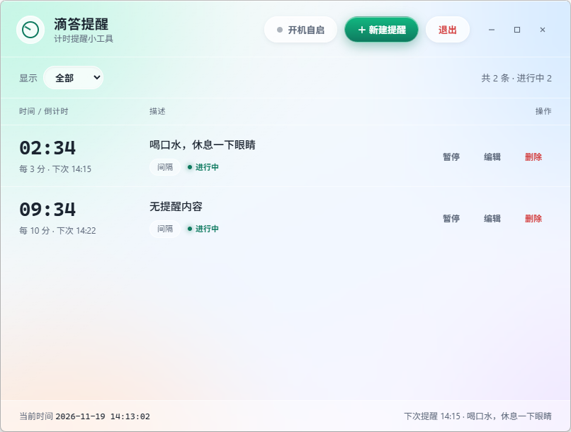

# 滴答提醒 (Dida Reminder)

一个 Windows 桌面计时提醒小工具：毛玻璃（Liquid Glass）界面、九种提醒类型、独立置顶弹窗，到点只弹出提醒卡片，主界面不会抢焦点。常驻系统托盘，安静地待在后台。



## 功能

- **九种提醒类型**：间隔重复、倒计时、单次定时、每小时、每天、工作日、每周、每月、每年。
- **列表管理**：暂停 / 恢复 / 编辑 / 删除、按状态筛选（全部 / 进行中 / 已暂停 / 已过期），双击行快速暂停或恢复。
- **独立置顶弹窗**：提醒到点时只把小弹窗置顶到最前，主窗口保持原位；带提示音、超时计时与「5 分钟后再响」贪睡。
- **托盘常驻**：关闭主窗口只是隐藏到托盘；托盘与右键菜单提供新建、测试提醒、全部暂停 / 恢复、删除全部（带确认）、开机自启、退出。
- **开机自启**：一键开关登录时自动启动。
- **单层窗口 chrome**：隐藏系统标题栏，标题栏与窗口控件画在毛玻璃内部，整窗为一块连续玻璃表面（保留原生圆角、阴影与缩放边）。
- **键盘可达**：对话框焦点圈闭、Esc 关闭、Ctrl+Enter 保存，控件均有 aria 标签。

## 下载

前往 [Releases](../../releases) 页面下载 Windows 版：

- `DidaReminder-<版本>-windows-amd64-setup.exe`：安装版，写入开始菜单与卸载项。
- `DidaReminder-<版本>-windows-amd64-portable.exe`：免安装便携版，双击即用。

仅支持 Windows 10/11（x64），依赖系统自带的 WebView2 运行时。

## 从源码构建

需要 [Go](https://go.dev/)、[Bun](https://bun.sh/)（或 Node.js）与 Windows 构建环境。

```bash
bun install        # 安装前端依赖
bun run dev        # 开发模式（热更新）
bun run build      # 生成 build/windows-amd64/ 下的 exe 与安装包
bun run typecheck  # 前端类型检查
go test ./...      # 后端测试
```

构建产物位于 `build/windows-amd64/`。

## 技术栈

- **后端**：Go + [MyGo](https://github.com/egoist/mygo) 0.8.3（窗口、托盘、菜单、定时引擎、持久化）。
- **前端**：React 18 + TypeScript + Vite，运行于 WebView2；毛玻璃视觉为纯 CSS（backdrop-filter）。
- **通信**：MyGo 类型化 IPC，`src/mygo.ts` 由 `mygo generate` 自动生成。

## 许可证

[MIT](LICENSE)